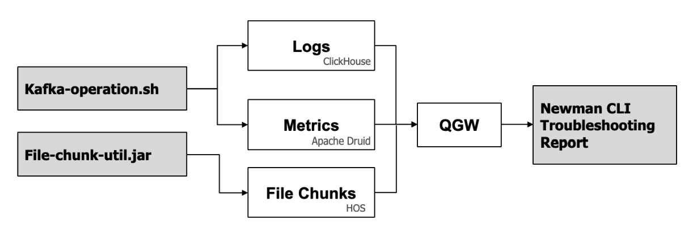

# TSG OLAP End-to-End Test

## 概述

TSG OLAP的数据摄入分为三种类型：Logs、Metrics 和 File Chunks。为确保能够正确处理并写入相应存储系统，需要支持端到端业务自检。


## 环境依赖

- Logs和Metric生成工具 `kafka-operation.sh` ，详细参考[帮助文档](https://docs.geedge.net/pages/viewpage.action?pageId=8029767)
- File Chunks生成工具 `file-chunk-util.jar`
- 安装`Newman`，详细参考[帮助文档](https://learning.postman.com/docs/collections/using-newman-cli/newman-options/)

## 使用方法

### 配置QGW API 

- 修改 `enviroment.json`，配置QGW的IP地址和端口 (首次安装)
```json
  {
        "key": "qgw_ip",
        "value": "192.168.44.30",
        "type": "default",
        "enabled": true
},
{
        "key": "qgw_port",
        "value": "9999",
        "type": "default",
        "enabled": true
}
```
### 配置File Chunks 生成工具

- 修改`config.properties`, 增加Kafka Topic名称和连接地址
```props
kafka.server=192.168.41.29:9092 
kafka.topic=TRAFFIC-FILE-STREAM-RECORD
```

### 写入测试集至Kafka
- Logs
```shell
cd tsg_olap_e2e_test/ 

kafka-operation.sh producer SESSION-RECORD < ./datasets/logs/session_record.dat

kafka-operation.sh producer VOIP-RECORD < ./datasets/logs/voip_record.dat

kafka-operation.sh producer PROXY-EVENT < ./datasets/logs/proxy_event.dat
```
- Metrics

```shell
cd tsg_olap_e2e_test/ 

kafka-operation.sh producer NETWORK-TRAFFIC-METRIC < ./datasets/metrics/network_traffic_metric.dat

kafka-operation.sh producer POLICY-RULE-METRIC < ./datasets/metrics/policy_rule_metric.dat

kafka-operation.sh producer OBJECT-STATISTICS-METRIC < ./datasets/metrics/object_statistics_metric.dat

kafka-operation.sh producer STATISTICS-RULE-METRIC < ./datasets/metrics/statistics_rule_metric.dat
```

- Files(与日志路径对应)

```shell
cd flie-chunk-util/

java -jar file-chunk-util.jar -n 123e4567-e89b-12d3-a456-426614174001 --file_type pcapng

java -jar file-chunk-util.jar -n 123e4567-e89b-12d3-a456-426614174002 --file_type html

java -jar file-chunk-util.jar -n 123e4567-e89b-12d3-a456-426614174003 --file_type html

java -jar file-chunk-util.jar -n 123e4567-e89b-12d3-a456-426614174004 --file_type eml

java -jar file-chunk-util.jar -n 123e4567-e89b-12d3-a456-426614174005 --file_type pcapng

```

### 输出故障诊断报告（等待5分钟）

```shell
# -n 执行次数 --folder 测试目录，logs，metrics，files；不指定将对所有模块进行自检
# Logs进行故障诊断，输出诊断明细
newman run ./collection.json -n 3 -e ./environment.json --delay-request 1000 --timeout-script 10000 --timeout-request 300000 --timeout 3600000 --insecure  --verbose --ignore-redirects --folder logs 

#Logs进行故障诊断，通过表情形式输出测试结果
newman run ./collection.json -n 3 --delay-request 1000 -e ./environment.json --ignore-redirects --folder logs -r emojitrain

#Logs进行故障诊断，输出报告json格式，自动存储newman目录
newman run ./collection.json -n 3 --delay-request 1000 -e ./environment.json --ignore-redirects --folder logs -r cli,json

```


